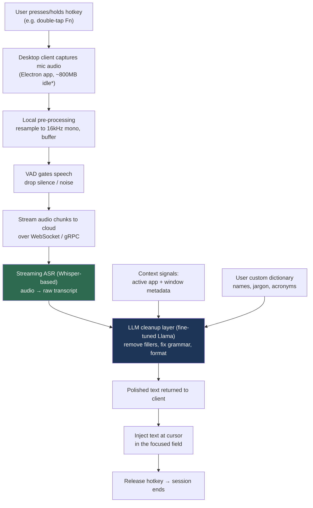
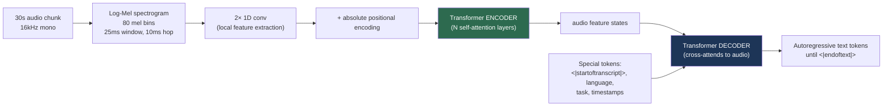

# Wispr Flow, End to End

> Research reference for building a Whisper-powered voice-dictation flow (a "Wispr Flow"-style app).
> Covers the product's end-to-end runtime flow, the Whisper ASR pipeline underneath it, the
> real-time streaming machinery, the serving infrastructure, and a build blueprint for a clone.
>
> Last researched: 2026-09-29. Third-party performance numbers are attributed inline; treat vendor
> claims as claims, not measurements you've reproduced.

---

## 1. What "Wispr Flow" actually is

Wispr Flow is a **system-wide voice dictation tool**. You hold a hotkey, talk, and cleaned-up text
appears at your cursor in *whatever* app is focused — Gmail, Slack, VS Code, a terminal. The thing
that makes it feel different from raw dictation is that it does **not** transcribe you literally. It
runs a second AI pass that removes filler words ("um", "like"), fixes grammar, restructures
sentences, and adapts tone to the target app, so the output reads like what you *meant* to type, not
a transcript of what you said. ([wisprflow.ai](https://wisprflow.ai/), [Netolink guide](https://netolink.com/wispr-flow/))

So the product is really **two models in a trench coat**:

1. **ASR** (speech → raw text) — a streaming, Whisper-based recognizer.
2. **LLM cleanup** (raw text → polished text) — a fine-tuned Llama that formats and contextualizes.

Everything else (hotkeys, audio capture, cursor injection, context detection, dictionary) is the
glue that turns those two models into an OS-level input method.

---

## 2. The end-to-end flow at a glance



`*` The ~800MB idle / ~8% CPU figures for the Electron client come from a third-party review
([Willow](https://willowvoice.com/blog/wispr-flow-review-voice-dictation)), not the vendor.

**One-line summary:** *hotkey → capture → VAD → stream → Whisper ASR → Llama cleanup (+context) →
inject at cursor.* Reported end-to-end latency is **<700 ms at p99** per the infra vendor, though
users describe the felt round-trip as closer to **1–2 s** for a full utterance
([Baseten](https://www.baseten.co/resources/customers/wispr-flow/), [Willow](https://willowvoice.com/blog/wispr-flow-review-voice-dictation)).

---

## 3. Stage-by-stage breakdown

### Stage 1 — Activation (the trigger)
- Bound to a **customizable global hotkey** — the default is a double-press / hold of `Fn`
  ([Netolink](https://netolink.com/wispr-flow/)).
- Two interaction models matter: **push-to-talk** (hold key while speaking, release to finish) and
  **toggle** (tap to start, tap to stop). Push-to-talk gives the cleanest end-of-utterance signal,
  which matters for latency (you don't need to *guess* when the user stopped).
- The client must register an OS-level global hotkey and grab focus context *before* audio starts.

### Stage 2 — Audio capture
- Grab the default input device, capture PCM audio, **downsample to 16 kHz mono** — Whisper's
  expected input rate. Higher rates are wasted bits.
- Buffer into small frames (e.g. 20–30 ms) for VAD, and accumulate into larger windows for the ASR.

### Stage 3 — Voice Activity Detection (VAD)
- A lightweight model (**Silero VAD** is the de-facto choice) runs locally and acts as a
  **gatekeeper**: it decides which frames contain speech and drops silence/background noise so you
  never pay Transformer inference on dead air.
  ([faster-whisper guide](https://neurlcreators.substack.com/p/how-do-you-build-a-real-time-speech))
- VAD also provides **endpointing**: detecting the trailing silence that means "the user finished a
  sentence," which lets you flush a chunk to the ASR without waiting for the hotkey release.
- Research pipelines pair Silero with an energy-based filter to cut false activations (~34% fewer in
  one paper). ([WhisperPipe](https://pith.science/paper/2604.25611))

### Stage 4 — Transport to the cloud
- Audio chunks stream over a **WebSocket** (or gRPC) connection — the standard for low-latency,
  continuous, bidirectional audio.
  ([Modan](https://saif-portfolio-seven-sigma.vercel.app/blog/real-time-audio-transcription-websockets-faster-whisper.html))
- Wispr Flow processes **in the cloud** (it is not primarily an offline tool), on **dedicated
  (single-tenant) deployments** on **Baseten over AWS `us-east-1`** — chosen specifically so sensitive
  audio never touches shared multi-tenant infra. ([Baseten](https://www.baseten.co/resources/customers/wispr-flow/))

### Stage 5 — Streaming ASR (the Whisper stage)
- The recognizer is described as **"Streaming ASR (Whisper-based)."** ([Netolink](https://netolink.com/wispr-flow/))
- Whisper itself is a batch, 30-second-window model, so "streaming Whisper" means wrapping it with a
  chunking + overlap strategy (see §4 and §5). It converts speech to a **raw, literal transcript**.

### Stage 6 — LLM cleanup & formatting (the "Flow" magic)
- A **real-time LLM layer** takes the raw transcript and rewrites it: strips fillers, fixes grammar,
  restructures run-on speech into clean sentences, applies formatting.
  ([Netolink](https://netolink.com/wispr-flow/))
- The model is a **fine-tuned Meta Llama**, tuned specifically for transcript-cleanup, served on
  Baseten. Reported: **100+ tokens in <250 ms**, using the **TensorRT-LLM** engine builder and
  Baseten's **Chains** framework to orchestrate the multi-step pipeline.
  ([Baseten](https://www.baseten.co/resources/customers/wispr-flow/))

### Stage 7 — Context awareness
- The cleanup model is conditioned on **active application + active window metadata**: formal prose
  for Gmail, casual for Slack, code formatting for VS Code. ([Netolink](https://netolink.com/wispr-flow/))
- Practically: the client reads the foreground app/window title and passes it as a signal (a system
  prompt hint or classifier feature) to the LLM.

### Stage 8 — Text injection
- The polished text is **injected at the cursor** in the focused field. ([Netolink](https://netolink.com/wispr-flow/))
- Implementation options: synthesize keystrokes, or write to the clipboard and paste, or use OS
  accessibility APIs (macOS Accessibility / Windows UIA) to insert text into the focused control.
  Keystroke synthesis is most universal; clipboard-paste is fastest for large blocks but clobbers
  clipboard state.

### Stage 9 — Power features layered on top
- **Custom dictionary:** user/org-seeded brand terms, names, acronyms bias recognition and cleanup.
- **Snippets:** spoken cues expand into pre-formatted text blocks.
- **AI Command Mode:** select text, speak an instruction, and the LLM performs an inline edit.
  ([Netolink](https://netolink.com/wispr-flow/))

### Stage 10 — Privacy
- Advertised **Zero Data Retention**: audio and transcripts processed transiently, not stored or used
  for training; enterprise tier claims SOC 2 Type II and HIPAA.
  ([Netolink](https://netolink.com/wispr-flow/), [Baseten](https://www.baseten.co/resources/customers/wispr-flow/))
- Caveat worth flagging to users: it *is* cloud-processed, so audio does leave the device
  ([offline review](https://weesperneonflow.ai/en/blog/2026-02-09-wispr-flow-review-cloud-dictation-2026/)).

---

## 4. Inside Whisper (the ASR model itself)

Whisper is a **single, end-to-end encoder–decoder Transformer** trained on ~680k hours of weakly
supervised multilingual audio. ([OpenAI](https://openai.com/index/whisper/),
[Wikipedia](https://en.wikipedia.org/wiki/Whisper_(speech_recognition_system)))



**The pipeline, precisely:**

1. **Chunk to 30 s.** Audio is split into (or padded to) 30-second windows.
2. **Log-Mel spectrogram.** Convert the waveform to an **80-dimensional log-Mel filterbank**
   (large-v3 uses 128), with a **25 ms window** and **10 ms hop**. This is the model's actual input.
3. **Conv front end.** Two **1-D convolution layers** extract local acoustic features, then
   **absolute positional encoding** is added.
4. **Encoder.** A stack of Transformer self-attention layers turns the spectrogram into a sequence of
   audio feature states.
5. **Decoder.** A Transformer decoder **cross-attends** to those audio states and **autoregressively
   generates text tokens**, one at a time, until the end-of-text token.
6. **Special tokens do multitask control.** The same model does language ID, transcription,
   X→English translation, and phrase-level timestamps — all steered by special tokens fed to the
   decoder (`<|startoftranscript|>`, a language tag, a task tag, `<|notimestamps|>`, etc.).

([Medium explainer](https://medium.com/@helenjoy88/how-whisper-works-openais-speech-to-text-model-explained-928d9729ff63),
[HF: whisper-large-v3](https://huggingface.co/openai/whisper-large-v3))

**Why this matters for a dictation app:** Whisper is inherently a **batch, 30-second** model. It has
no native streaming mode, and its autoregressive decoder can **hallucinate** on silence or noise
(one reason VAD gating in front of it is not optional). Turning it real-time is an engineering layer,
not a model feature.

---

## 5. Making Whisper feel real-time

Since Whisper is batch-oriented, "streaming" is achieved with a wrapper:

- **VAD-gated chunking.** Run VAD first; only send active speech segments to Whisper. This alone is
  the single biggest latency and cost win.
  ([faster-whisper guide](https://neurlcreators.substack.com/p/how-do-you-build-a-real-time-speech))
- **Overlapping context windows.** Feed slightly overlapping chunks so words spanning a boundary
  aren't cut, then de-duplicate the overlap in the output (the "LocalAgreement"/streaming-Whisper
  approach). ([Whisper-Streaming paper](https://arxiv.org/pdf/2307.14743))
- **Faster inference engine.** Use **faster-whisper** (CTranslate2) rather than the reference
  implementation — substantially lower latency for the same weights, and the common choice for
  production real-time pipelines.
- **Adaptive buffering.** Trade a little accuracy for latency by tuning chunk size dynamically;
  research systems report bounded memory and low double-digit-ms medians with this approach
  ([WhisperPipe](https://pith.science/paper/2604.25611) — a research figure, not a product SLA).

A widely-cited reference stack for this is **FastAPI WebSocket + Silero VAD + faster-whisper**
([Modan](https://saif-portfolio-seven-sigma.vercel.app/blog/real-time-audio-transcription-websockets-faster-whisper.html)).

---

## 6. Serving infrastructure (how Wispr runs it in prod)

| Concern | Wispr Flow's choice | Source |
|---|---|---|
| Cloud | AWS (`us-east-1`) | Baseten |
| Model host | Baseten, **dedicated (single-tenant)** deployments | Baseten |
| ASR | Streaming, Whisper-based | Netolink |
| Cleanup LLM | **Fine-tuned Llama**, owned end-to-end | Baseten |
| LLM engine | **TensorRT-LLM** engine builder | Baseten |
| Orchestration | **Baseten Chains** (multi-step pipeline) | Baseten |
| Latency target | **<700 ms p99** end-to-end; 100+ tokens in <250 ms | Baseten |
| Scaling | Autoscaling GPUs for spikes | Baseten |
| Compliance | SOC 2 Type II, HIPAA (enterprise) | Baseten |

Design philosophy quoted by the vendor: *"We're optimizing the p99 experience for the p99 user"* —
i.e. they tune the tail latency, not the median, because a dictation tool that occasionally stalls
feels broken. ([Baseten](https://www.baseten.co/resources/customers/wispr-flow/))

---

## 7. Latency budget (where the ~700 ms goes)

A useful mental model for the round-trip after you stop speaking:

```
endpoint detection (VAD trailing silence)   ~100–200 ms
network up (audio chunk → cloud)              ~20–80 ms
Whisper ASR on the final segment              ~150–400 ms
Llama cleanup (100+ tokens)                   <250 ms
network down + cursor injection               ~20–80 ms
------------------------------------------------------
felt total                                    ~0.7–2 s
```

The two knobs that dominate: **endpointing** (how aggressively you decide the user is done) and **ASR
inference** (engine + chunk size). The cleanup LLM is fast because it's short-output and
TensorRT-optimized.

---

## 8. Build blueprint — if we clone this

A minimal but faithful architecture, with concrete tech choices per stage:

| Stage | Build option (pragmatic) | Notes |
|---|---|---|
| Desktop client | **Electron** or **Tauri** (Tauri = far lighter than Electron's ~800MB) | Needs global hotkey + accessibility perms |
| Global hotkey | OS hotkey API (e.g. `uiohook`, `tauri-plugin-global-shortcut`) | Push-to-talk is easiest to get right |
| Audio capture | 16 kHz mono PCM via native mic API | Downsample immediately |
| VAD | **Silero VAD** locally | Gate speech + endpointing |
| Transport | **WebSocket** to backend | Bidirectional, low-latency |
| ASR | **faster-whisper** (self-host) or a hosted Whisper API | Start hosted, self-host to cut cost/latency |
| Cleanup LLM | Any instruct model with a cleanup system prompt; fine-tune later | This is the differentiator — invest here |
| Context | Read foreground app + window title, pass as prompt hint | macOS Accessibility / Windows UIA |
| Injection | Keystroke synthesis (universal) or clipboard-paste (fast) | Restore clipboard after paste |
| Dictionary/snippets | Bias terms in the cleanup prompt + local substitution table | Cheap, high user-value |

**Sequence to build it (smallest useful slice first):**
1. Hotkey → capture → save WAV → send to a hosted Whisper → print transcript. (Proves the loop.)
2. Add cursor injection so text lands in the focused app.
3. Add the LLM cleanup pass with an app-context system prompt.
4. Add Silero VAD + WebSocket streaming to make it feel instant.
5. Add dictionary, snippets, command mode.

**The 80/20:** the ASR is a commodity you can buy; the **cleanup LLM + context awareness + reliable
cursor injection** are what make it feel like Wispr Flow rather than a dictation box.

---

## 9. Key risks / gotchas

- **Whisper hallucinates on silence** — VAD in front is mandatory, not optional.
- **Cursor injection is the fiddly part** — accessibility permissions, focus races, secure input
  fields (password boxes block synthetic keystrokes), and clipboard clobbering.
- **Cloud round-trip = privacy surface** — audio leaves the device; be explicit with users, and
  consider an offline (local whisper.cpp) mode as a differentiator.
- **Electron is heavy** (~800 MB idle reported) — Tauri is worth considering for a from-scratch build.
- **Latency tail, not median** — a p50 that's great but a p99 that stalls feels broken; budget for
  the tail.

---

## Sources

- [Wispr Flow — product site](https://wisprflow.ai/)
- [Baseten — Wispr Flow customer story (infra, models, latency)](https://www.baseten.co/resources/customers/wispr-flow/)
- [Netolink — Wispr Flow architecture & workflow guide](https://netolink.com/wispr-flow/)
- [Willow — Wispr Flow review (client resource use, felt latency)](https://willowvoice.com/blog/wispr-flow-review-voice-dictation)
- [Weesper — "Does Wispr Flow work offline?" (cloud dependency)](https://weesperneonflow.ai/en/blog/2026-02-09-wispr-flow-review-cloud-dictation-2026/)
- [OpenAI — Introducing Whisper](https://openai.com/index/whisper/)
- [Wikipedia — Whisper (speech recognition system)](https://en.wikipedia.org/wiki/Whisper_(speech_recognition_system))
- [Medium — How Whisper Works](https://medium.com/@helenjoy88/how-whisper-works-openais-speech-to-text-model-explained-928d9729ff63)
- [Hugging Face — openai/whisper-large-v3](https://huggingface.co/openai/whisper-large-v3)
- [Whisper-Streaming — Turning Whisper into Real-Time Transcription (arXiv 2307.14743)](https://arxiv.org/pdf/2307.14743)
- [Building Real-Time Speech-to-Text with Faster-Whisper (Silero VAD)](https://neurlcreators.substack.com/p/how-do-you-build-a-real-time-speech)
- [Ultra-Low Latency Transcription with WebSockets + Faster-Whisper](https://saif-portfolio-seven-sigma.vercel.app/blog/real-time-audio-transcription-websockets-faster-whisper.html)
- [WhisperPipe — resource-efficient streaming ASR (research)](https://pith.science/paper/2604.25611)
